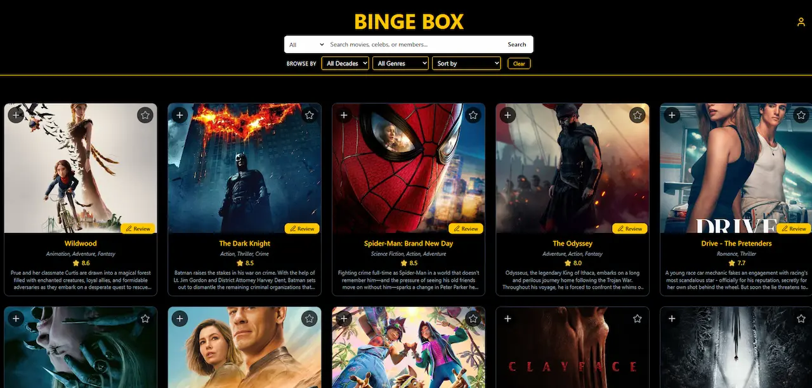

# Binge Box
 
A fullstack movie community where users discover films, write reviews, build watchlists and follow each other. Movie and celebrity data comes from **The Movie Database (TMDb)**, while all user-generated content is stored in a custom **ASP.NET Core Web API**.


 
---
 
## Features
 
**Discover**
- Browse popular movies on the start page
- Search movies, celebrities and other members
- Filter by genre, decade and rating
- Detail pages for movies and people (cast, crew, filmography)
- **Movie of the Week**, a featured film chosen by an admin
**Community**
- Register and log in with JWT authentication
- Write, edit and delete reviews with ratings
- Like reviews and comment on them
- Follow other users and see their profiles
- Personal profile with avatar upload, favorites and watchlist
**Admin**
- Role-based admin panel (`Admin` / `User`)
- Set the Movie of the Week
- Moderate content
---
 
## Tech Stack
 
| Layer | Technology |
|---|---|
| Frontend | React 19, Vite, React Router, Tailwind CSS, Lucide icons |
| Backend | ASP.NET Core 8 Web API (C#) |
| Database | Entity Framework Core 9, SQL Server (LocalDB) |
| Auth | JWT Bearer tokens, BCrypt password hashing, role-based authorization |
| External API | TMDb API via a typed `HttpClient` |
| Docs | Swagger / OpenAPI with JWT support |
 
---
 
## Architecture
 
```
binge-box/
├── Binge Box/              # ASP.NET Core Web API
│   ├── Controllers/        # REST endpoints (auth, reviews, watchlist, followers …)
│   ├── Models/             # EF Core entities
│   ├── DTOs/               # Request/response objects per feature
│   ├── Data/               # AppDbContext
│   ├── External/Tmdb/      # TMDb client + DTOs
│   ├── Migrations/         # EF Core migrations
│   └── Program.cs          # DI, JWT, CORS, Swagger
└── frontend/               # React + Vite client
    └── src/
        ├── pages/          # Routes (movie, person, profile, admin …)
        ├── components/     # Navbar, MovieCard, SearchBar, filters …
        ├── context/        # Auth and favorites state
        ├── hooks/          # useAuth, useWatchlist, useFavorites
        └── api.js          # Central fetch helper with JWT
```
 
The frontend never talks to TMDb directly. All requests go through the backend, which keeps the API key on the server and lets the app combine TMDb data with its own data (reviews, likes, favorites).
 
**Nathalie Kanfjäll Baskin**
[Portfolio](https://www.nathaliebaskin.com) · [LinkedIn](https://www.linkedin.com/in/nathalie-baskin-b61790193) · [GitHub](https://github.com/Namahka)
 
This product uses the TMDb API but is not endorsed or certified by TMDb.
